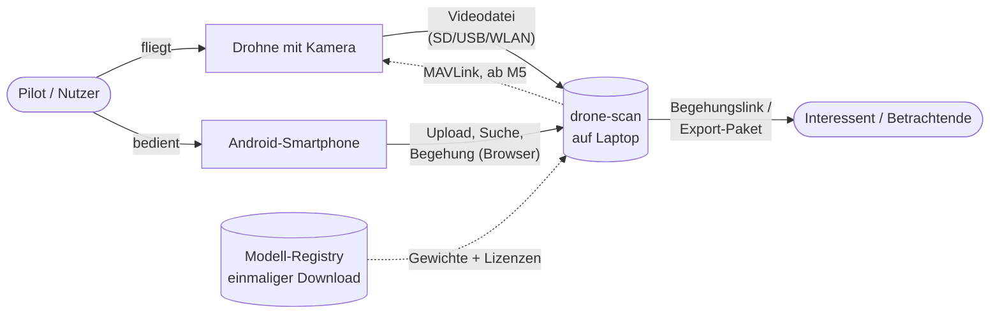
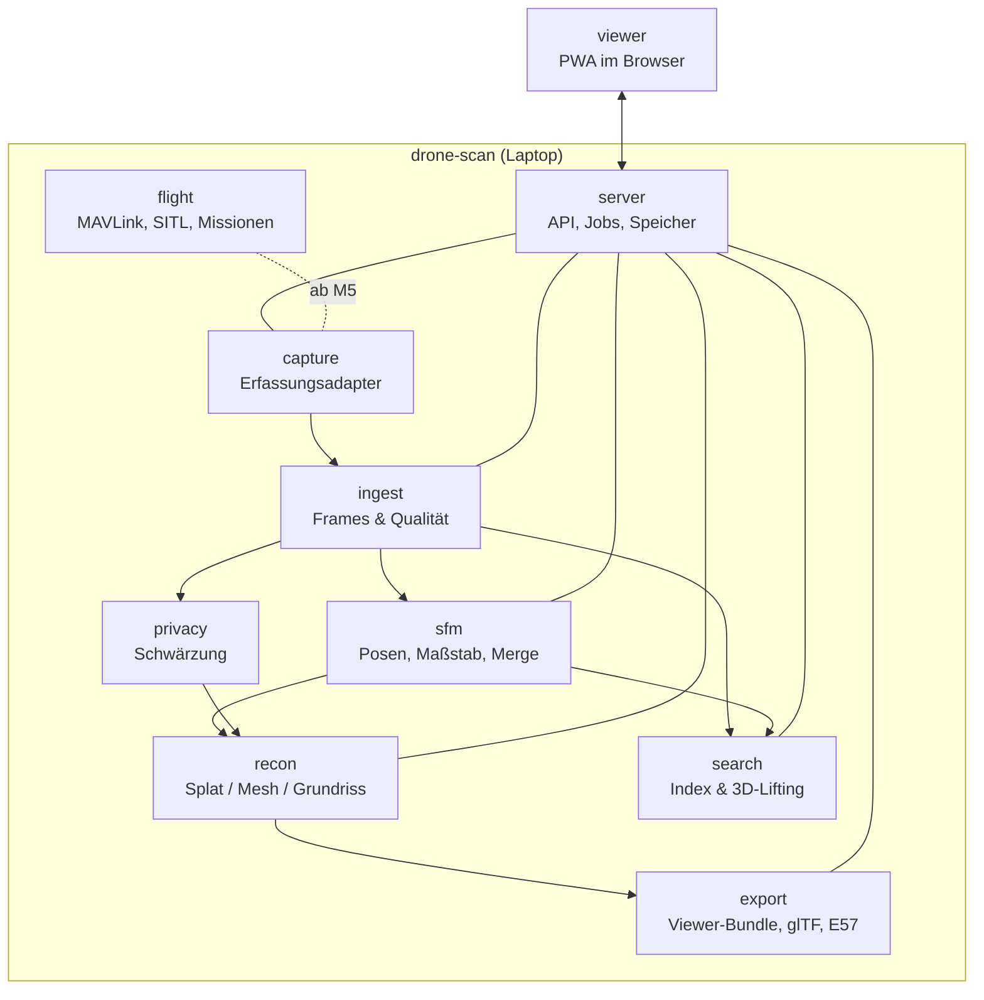
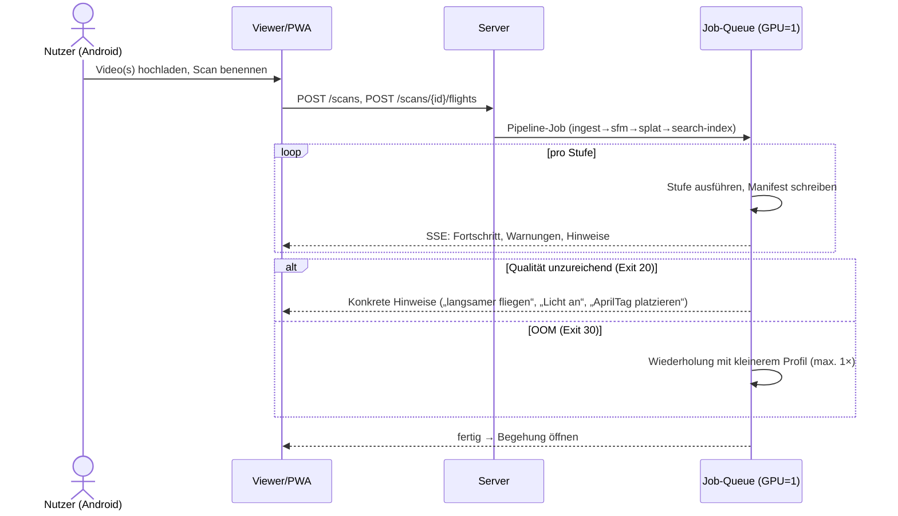
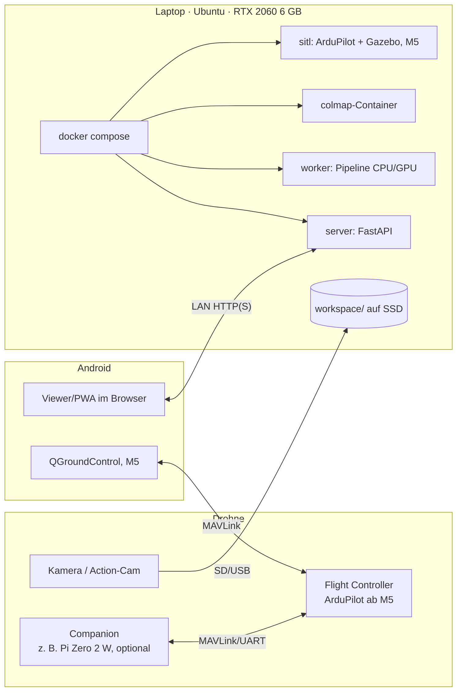

# Architektur – drone-scan (Arbeitstitel)

> Gliederung nach **arc42** (Version 8). Stand: 20.11.2026 · Status: Entwurf v0.1 · Verantwortlich: Product Owner
> Verwandte Dokumente: [Projektmanagement](projektmanagement.md) · [User Stories](user-stories.md) · [Drohnen-Recherche](drohnen-recherche.md) · [ADRs](adr/)

---

## 1. Einführung und Ziele

### 1.1 Aufgabenstellung

Kleine Drohnen fliegen durch Gebäude und nehmen dabei Videos auf. Aus diesen Videos erzeugt das System **3D-Modelle der Innenräume**. Damit sind zwei Anwendungsfälle möglich:

| ID | Anwendungsfall | Kurzbeschreibung |
|---|---|---|
| UC-1 | **Verlorene Gegenstände finden** | Nutzer fragt per Text („Schlüsselbund“, „rote Brille“). Das System zeigt Fundstellen mit Belegbildern im 3D-Modell. |
| UC-2 | **Virtuelle Begehung** | Für Verkaufs- und Vermietungsgespräche wird eine begehbare, im Browser teilbare 3D-Szene mit Raumliste und Maßangaben erstellt. |
| UC-3 | Grundriss / Maße *(optional)* | Aus der Rekonstruktion werden ein 2D-Grundriss und ungefähre Flächen abgeleitet (ausdrücklich **nicht** rechtsverbindlich, z. B. keine Wohnfläche nach WoFlV). |

**Annahme (gesetzt):** Während des Flugs befinden sich keine Personen oder Tiere im Gebäude.

### 1.2 Qualitätsziele (Top 5, nach ISO/IEC 25010)

| Prio | Qualitätsziel | Konkretisierung |
|---|---|---|
| 1 | **Effizienz auf Consumer-Hardware** | Läuft vollständig auf einem Laptop mit RTX 2060 (6 GiB VRAM). Keine Stufe überschreitet 5,5 GiB VRAM pro Prozess (inkl. CUDA-Kontext). |
| 2 | **Rechtssicherheit / Lizenzreinheit** | Ausschließlich Open Source. Kommerzielle Nutzung muss möglich sein, also keine Komponenten mit „non-commercial“-Lizenz. |
| 3 | **Datenschutz** | Offline-first: Alle Daten bleiben lokal. Es gibt keine Cloud-Pflicht und keine Telemetrie. |
| 4 | **Robustheit** | Schlechtes Material (Unschärfe, texturarme Wände, mehrere Akkuflüge) führt zu verwertbaren Ergebnissen oder zu **konkreten Handlungsempfehlungen**. |
| 5 | **Bedienbarkeit** | Laien kommen ohne Kommandozeile vom Video zur Begehung („Ein-Klick-Pipeline“, Bedienung per Android-Browser). |

### 1.3 Stakeholder

| Rolle | Erwartung |
|---|---|
| Product Owner / Gründer | Tragfähiges MVP, kommerzialisierbar, geringe Kosten |
| Privatnutzer (Persona „Suchende“) | Findet Gegenstände schnell, ohne Technikwissen |
| Makler / Verkäufer (Persona „Präsentierende“) | Ansprechende, teilbare Begehung; Datenschutz gegenüber Eigentümern |
| Interessent (Persona „Betrachtende“) | Begehung per Link auf Smartphone oder Laptop, ohne Installation |
| Pilot (oft = Nutzer) | Sicheres, einfaches Fliegen, klare Anweisungen zur Aufnahme |
| Entwicklung (PO + Claude Code) | Klare Schnittstellen, testbare Stufen, reproduzierbare Ergebnisse |

---

## 2. Randbedingungen

| Typ | Randbedingung |
|---|---|
| Technisch | Zielrechner: Laptop mit **RTX 2060 (6 GB, Turing, CUDA Compute Capability 7.5)**, Ubuntu LTS. Endgerät: Android-Smartphone (aktueller Chrome/Firefox). |
| Technisch | **Entwicklungsrechner:** Desktop mit **GTX 1060 6GB (Pascal, Compute Capability 6.1)**. Die zusätzlich verbaute RTX 2070 SUPER ist reserviert und wird nur mit Zustimmung des POs genutzt. Claude Code läuft lokal auf diesem Rechner. Pascal wird von aktuellen PyTorch-Builds nur noch über **CUDA-12.6-Wheels** unterstützt, **PyTorch 2.14 ist die letzte Version mit vorgefertigten Paketen** (siehe ADR-0010). Builds werden daher für `sm_61` **und** `sm_75` erzeugt, Tests laufen mit 5,0-GiB-Allocator-Grenze, damit der Zielrechner abgebildet ist. |
| Technisch | Drohne: „einfache Drohne mit Kamera“, Entwicklung ca. 100 €, Endnutzer max. 500 € → **das System muss drohnen-agnostisch sein** (Videodatei als Minimalschnittstelle). |
| Lizenz | Nur Open Source. **Bevorzugt** MIT/BSD/Apache-2.0. **Copyleft** (GPL/AGPL) nur als eigenständiges Werkzeug bzw. als separater Prozess. **Verboten:** Lizenzen mit Nutzungsbeschränkung („non-commercial“, z. B. Inria-3DGS, DUSt3R/MASt3R, SuperPoint-Gewichte). |
| Organisatorisch | Ein Gründer als Product Owner, Implementierung überwiegend mit Claude Code. Projektmanagement in **Jira** (Projekt „DRN“ (Schlüssel `KAN`)). |
| Rechtlich | DSGVO bei Aufnahmen fremder Räume; Haftpflicht für Drohnenbetrieb klären. Reiner Innenraumflug unterliegt nach gängiger Auslegung nicht den EU-Luftraumregeln (keine Kenntnisnachweispflicht). Das ist vor dem kommerziellen Einsatz juristisch zu bestätigen. |
| Konventionen | Doku auf Deutsch, Code/Bezeichner/Commits auf Englisch. arc42 für Architektur, ADRs (Nygard-Format) für Entscheidungen. |

---

## 3. Kontextabgrenzung

### 3.1 Fachlicher Kontext



| Nachbar | Eingabe ins System | Ausgabe aus dem System |
|---|---|---|
| Drohne | Video (MP4/MOV), optional Telemetrie (CSV/MAVLink-Log) | ab M5: Flugbefehle (nur Simulation bzw. explizit freigegeben) |
| Android-Smartphone | Upload, Suchanfragen, Bedienung | Fortschritt, Begehung, Treffer |
| Betrachtende | – | statisches Viewer-Bundle oder Link im LAN |
| Modell-Registry (z. B. Hugging Face) | Modellgewichte (einmalig, versioniert, Lizenz geprüft) | – |

### 3.2 Technischer Kontext

- **Drohne → Laptop:** Dateitransfer (microSD, USB-Massenspeicher oder Herstellerapp → Smartphone → Upload). Es gibt keine Abhängigkeit von Hersteller-SDKs.
- **Smartphone ↔ Laptop:** HTTP(S) im lokalen Netz (REST + Server-Sent Events), PWA im Browser.
- **Laptop ↔ Drohne (ab M5):** MAVLink 2 über WLAN/UART-Telemetrie (ArduPilot). Zuerst ausschließlich gegen SITL (Software-in-the-Loop).

---

## 4. Lösungsstrategie

| Ziel / Problem | Strategie |
|---|---|
| Drohnen-Agnostik | **„Bring your own video“**: Die Videodatei ist die universelle Schnittstelle. Adapter (Tello, ArduPilot) sind optional. |
| 6 GB VRAM | **Offline-Batch-Pipeline** statt Echtzeit-SLAM. Pro Stufe gibt es VRAM-Profile, GPU-Jobs laufen strikt nacheinander, große Gebäude werden in Raumabschnitte aufgeteilt. |
| Qualität der Begehung | **3D Gaussian Splatting** (gsplat, Apache-2.0) als primäre Darstellung, Mesh nur optional. |
| Robuste Kameraposen | **COLMAP** (BSD) als SfM-Kern mit sequenziellem Matching und Loop-Detection, **AprilTags** für Maßstab und Lot. |
| Gegenstandssuche mit wenig VRAM | Suche in **2D-Frames** (Open-Vocabulary-Detektion + CLIP-Embeddings), anschließend **3D-Lifting** über die bekannten Kameraposen. Keine sprachfähigen 3D-Felder (LERF/LangSplat), weil diese zu viel VRAM brauchen. |
| Bedienbarkeit | Lokale **Web-App** (FastAPI) mit **PWA-Viewer**: Das Smartphone dient als Fernbedienung und Bildschirm. |
| Nachvollziehbarkeit | **Pipes & Filters** mit Artefakt-Manifesten (Eingabe-Hashes, Parameter, Tool-Versionen). Das ermöglicht Caching und Reproduzierbarkeit. |
| Flugautonomie (riskant) | **Simulation first** (ArduPilot SITL + Gazebo). Bis M4 wird manuell geflogen, Autonomie folgt erst in M5. |
| Lizenz-Compliance | Allowlist und automatischer Lizenzcheck in der CI, SBOM nach **SPDX (ISO/IEC 5962)** bzw. CycloneDX, Modell-Lockfile mit Lizenzfeld. |

---

## 5. Bausteinsicht

### 5.1 Ebene 1 – Gesamtsystem



| Baustein | Verantwortung | Wichtigste Technologie (Lizenz) |
|---|---|---|
| `capture` | Video/Telemetrie entgegennehmen, Metadaten (Kamera, Zeit, Flug-ID) erfassen; Adapter `VideoFile`, `Tello` (optional), `ArduPilot` (M5) | ffmpeg/ffprobe (LGPL), djitellopy (MIT), pymavlink (LGPL-3.0) / MAVSDK (BSD-3) |
| `ingest` | Dekodieren, Schärfefilter (Laplace-Varianz), Duplikat- und Bewegungsfilter, Keyframe-Auswahl, Belichtungsprüfung, Qualitätsreport mit Handlungsempfehlungen | OpenCV (Apache-2.0), ffmpeg |
| `sfm` | Features, Matching (sequenziell + Loop), Mapping, AprilTag-Erkennung → metrischer Maßstab + Schwerkraftausrichtung, Zusammenführen mehrerer Flüge | COLMAP (BSD-3), pycolmap, AprilTag (BSD-2) |
| `recon.splat` | Gaussian-Splatting-Training mit VRAM-Profil, Komprimierung (SPZ), Qualitätsmetriken (PSNR/SSIM auf Validierungsframes) | gsplat (Apache-2.0), Nerfstudio (Apache-2.0) optional |
| `recon.mesh` *(optional)* | Mesh aus Tiefen/TSDF oder OpenMVS als **separates Werkzeug** | Open3D (MIT), OpenMVS (AGPL-3.0, nur als CLI-Prozess) |
| `recon.floorplan` *(optional)* | Horizontalschnitt → 2D-Polygon, Flächen ±10 % | Shapely (BSD), Open3D |
| `search` | Pro Keyframe Detektionen + Embeddings → Vektorindex; Textanfrage → Kandidaten → Mehrfachsicht-Triangulation → 3D-Marker mit Konfidenz + Belegbildern | OWLv2 / Grounding DINO (Apache-2.0), OpenCLIP (MIT), FAISS (MIT), SAM 2 (Apache-2.0) optional |
| `privacy` | Gesichter, Bildschirme, Dokumente erkennen und unkenntlich machen (vor Training **oder** vor Export) | OpenCV-DNN, freie Detektoren (Lizenz je Modell prüfen) |
| `export` | Statisches Viewer-Bundle (offline teilbar), glTF 2.0 (+ `KHR_gaussian_splatting`), PLY, E57 | eigene Implementierung, pygltflib (MIT) |
| `server` | REST-API (OpenAPI 3.1), Job-Queue (GPU-Concurrency = 1), Fortschritt via SSE, Speicherverwaltung, Löschfunktion | FastAPI (MIT), SQLite, Pydantic (MIT) |
| `viewer` | Begehung (Splat-Rendering), Raumliste, Suche, Marker, Upload, Jobstatus; als PWA installierbar | TypeScript, Vite (MIT), three.js (MIT) + Spark bzw. PlayCanvas-Engine (MIT) |
| `flight` *(M5)* | Missionen (Raster-/Wandfolgeflug), Geofence, Failsafes, SITL-Welten, später Exploration | ArduPilot (GPL-3.0, unverändert genutzt), Gazebo (Apache-2.0), ROS 2 (Apache-2.0) |
| `common` | Datenmodell, Konfiguration (Profile), Logging, VRAM-Budget, CLI | Pydantic, Typer (MIT), structlog (MIT/Apache) |

> **Lizenzhinweis:** Alle Lizenzangaben werden bei Aufnahme einer Abhängigkeit im Lizenzregister (`licenses/allowlist.yaml`, `models.lock`) **erneut verifiziert** (User Story „Lizenz-Gate“). Bei Modellen gilt die Lizenz der **Gewichte**, nicht die des Codes.

### 5.2 Ebene 2 – Stufenvertrag (gilt für jede Pipeline-Stufe)

Jede Stufe ist ein **idempotenter CLI-Befehl** mit festem Vertrag:

```text
drone-scan <stufe> --scan <scan_dir> [--profile low_vram_6gb] [--force]
  liest:     definierte Eingabeartefakte
  schreibt:  <scan_dir>/<stufe>/...  +  <scan_dir>/<stufe>/manifest.json
  manifest:  {stage, version, inputs:{pfad: sha256}, params, tools:{name: version},
              started, finished, peak_vram_mb, status, warnings[], hints[]}
  Exitcodes: 0 ok · 10 Eingabe fehlt · 20 Qualität unzureichend (mit hints) · 30 OOM · 1 sonstiger Fehler
```

Ist ein Manifest gültig (die Eingabe-Hashes und Parameter sind unverändert), wird die Stufe übersprungen (Cache).

Umsetzung (KAN-21): Basisklasse `dronescan.common.stage.Stage` und `run_stage()`.
- **Manifest:** Es wird immer atomar geschrieben, auch bei Fehlern, damit Status und `hints` für Server und UI vorliegen. Nur `status: ok` gilt als Cache. Der Cache-Schlüssel umfasst Stufenversion, Input-Hashes, Parameter (JSON-normalisiert) und Tool-Versionen. Eingaben müssen im Scan-Verzeichnis liegen; absolute Pfade werden aus Fehlertexten entfernt. Zusätzlich werden das Profil, `exit_code` und `error` festgehalten.
- **GPU-Stufen** (`uses_gpu = True`): `run_stage()` setzt vor dem Lauf das VRAM-Limit (`common.gpu.apply_vram_limit`). `peak_vram_mb` stammt aus `torch.cuda.max_memory_reserved` und enthält damit noch nicht den CUDA-Kontext; die Messung pro Prozess folgt mit KAN-41.
- **OOM** (`OutOfMemoryError`, „out of memory“, `MemoryError`) ergibt Exit 30 mit Abhilfe. Die automatische Wiederholung mit kleinerem Profil übernimmt die Job-Queue.
- **CLI:** `register_stage(app, StageClass)` erzeugt `drone-scan <stufe> --scan --profile --force`.
- **Fehlercodes:** siehe `docs/fehlercodes.md`.

### 5.3 Datenmodell / Artefakt-Layout

```text
workspace/<scan_id>/                 # ein Gebäude/Objekt, eine Erfassungskampagne
  scan.yaml                          # Name, Adresse (optional), Datum, Drohne, Kamera, Notizen
  flights/<flight_id>/video.mp4      # ein Akku = ein Flug
  flights/<flight_id>/telemetry.csv  # optional
  ingest/<flight_id>/frames/*.jpg, frames.parquet, manifest.json, quality.json
  sfm/colmap/{database.db, sparse/0}, sfm/aligned/{transform.json, scale_report.json}
  recon/splat/{scene.ply, scene.spz, metrics.json}, recon/mesh/scene.glb, recon/floorplan/plan.svg
  search/{detections.parquet, embeddings.faiss, objects.json}
  export/viewer_bundle/, export/scene.gltf, export/pointcloud.e57
  reports/summary.json
```

Domänenobjekte: `Scan` 1–n `Flight` 1–n `Frame` · `Scan` 1–1 `Reconstruction` · `Scan` 1–n `Room` · `Scan` 1–n `ObjectHit (label, xyz, confidence, evidence_frames[])` · `Scan` 1–n `Annotation`.

---

## 6. Laufzeitsicht

### 6.1 Szenario „Neuer Scan aus Video“ (MVP)



### 6.2 Szenario „Wo ist mein Schlüssel?“

1. Der Nutzer gibt „Schlüsselbund“ ein (optional mit Raumfilter).
2. `search` bildet Text-Embeddings und ermittelt die Top-k-Frames per FAISS. Auf diesen Kandidaten läuft die Open-Vocabulary-Detektion (Box + Score).
3. Für Detektionen in ≥ 2 Frames wird **trianguliert** (Strahlenschnitt über die COLMAP-Posen). Ein Einzeltreffer wird über die Tiefe aus dem Splat-Rendering positioniert.
4. Ergebnis: Liste mit 3D-Markern (Raum, Konfidenz, 2–4 Belegbilder). Der Viewer fliegt zum Marker.
5. Ziel: Antwort in < 3 s nach der Indexierung.

### 6.3 Szenario „Mehrere Akkuflüge zusammenführen“

Jeder Flug wird einzeln registriert. Überlappende Bereiche (Türdurchgänge) und gemeinsame AprilTags verbinden die Teilmodelle. COLMAP-Modelle werden zusammengeführt. Schlägt das fehl, gibt es eine klare Anweisung für einen „Brückenflug“.

### 6.4 Szenario „Assistierter Flug“ (M5)

Grundriss-Skizze bzw. Geofence → Missionsplanung (Bahnen mit 60–80 % Bildüberlappung, ≤ 0,5 m/s) → **SITL-Validierung** → Freigabe durch den Menschen → Flug mit optischem Fluss und Abstandssensor → automatische Rückkehr bei schwachem Akku oder Verbindungsverlust.

---

## 7. Verteilungssicht



- Container: `server`, `worker` (CUDA, PyTorch, gsplat), `colmap` (offizielles Image bzw. eigener Build), `sitl` (M5). Das NVIDIA Container Toolkit wird vorausgesetzt.
- Speicherbedarf: ca. 2–8 GB pro Scan (Frames + Modelle). Eine Aufräumfunktion löscht Zwischenstufen.
- Netzwerk: nur LAN. Optional ein lokales TLS-Zertifikat (z. B. via mkcert), damit die PWA installierbar ist.

---

## 8. Querschnittliche Konzepte

### 8.1 VRAM-Budget
- Profile `low_vram_6gb` (Standard) und `default_8gb`. Sie legen fest: max. Bildkante für SfM bzw. Training, Anzahl Iterationen, Obergrenze für Gaussians, Batchgrößen der Detektoren, fp16.
- Harte Grenze in Tests: `torch.cuda.set_per_process_memory_fraction`. Dadurch wird der Zielrechner auch auf stärkeren Entwicklungsrechnern simuliert.
- Umsetzung (KAN-20):
  - **Profile:** liegen als YAML in `src/dronescan/common/profiles/`. `common.config.load_settings()` lädt sie mit dieser Priorität: Umgebungsvariable `DRONESCAN_*` > Profil. Verschachtelte Werte werden mit `__` angesprochen, z. B. `DRONESCAN_SPLAT__MAX_GAUSSIANS`. Das Profil wählt `--profile`, sonst `DRONESCAN_PROFILE`, sonst `low_vram_6gb`.
  - **VRAM-Grenze:** `DRONESCAN_VRAM_LIMIT_GB` (in GiB) überschreibt `vram_limit_gb` (Profil `low_vram_6gb`: 5,0 GiB für den PyTorch-Allocator; CUDA-Kontext kommt hinzu, Ziel ≤ 5,5 GiB gesamt). `common.gpu.apply_vram_limit()` setzt daraus beim Start jeder GPU-Stufe den Speicheranteil. Der CUDA-Kontext selbst ist nicht begrenzt, deshalb bleibt Puffer unter 6 GB.
  - **Präzision:** `common.gpu.use_fp16()` erlaubt fp16 nur ab sm_70. Auf Pascal läuft immer fp32 (ADR-0010).
  - **Anzeige:** `drone-scan config [--profile …]` zeigt die wirksame Konfiguration.
- Bei OOM wird einmal automatisch mit verkleinertem Profil wiederholt. `peak_vram_mb` steht im Manifest.

### 8.2 Aufnahmequalität (Capture Guidance)
- Vor dem Flug zeigt der Viewer eine Checkliste: Licht an, Türen offen, Spiegel/Glas notieren, 2–4 AprilTags auslegen, langsam fliegen (≤ 0,5 m/s), Wände in 1–1,5 m Abstand, jeden Raum einmal umrunden, Türdurchgänge doppelt.
- Nach dem Upload liefert `ingest/quality.json` Schärfeverteilung, Bewegungsgeschwindigkeit, Belichtung und Abdeckung samt Handlungsempfehlungen.

### 8.3 Reproduzierbarkeit & Caching
Es gibt Manifeste pro Stufe, gepinnte Abhängigkeiten (`uv.lock`), ein `models.lock` (Name, Version, SHA-256, Lizenz, Quelle) und feste Seeds.

### 8.4 Lizenz-Compliance
`licenses/allowlist.yaml` (erlaubte SPDX-IDs), `licenses/denylist.yaml` (verbotene Pakete und Modelle mit Begründung). Der CI-Job prüft Python- und npm-Abhängigkeiten sowie das `models.lock`. Pro Release wird eine SBOM erzeugt (SPDX/CycloneDX). Copyleft-Werkzeuge (OpenMVS, ArduPilot, ggf. ORB-SLAM3) werden nur als separater Prozess bzw. separates Image genutzt und nicht in den eigenen Code eingebunden.

### 8.5 Datenschutz (Privacy by Design, Art. 25 DSGVO)
Es gibt keine Cloud und keine Telemetrie. Die Anonymisierung ist **vor dem Export standardmäßig aktiv**. Löschen erfolgt pro Scan vollständig, inklusive Index und Cache. Optional kommt eine Einwilligungsnotiz des Eigentümers in `scan.yaml`. Exporte erhalten ein Wasserzeichen bzw. Metadaten („Aufnahmedatum, nicht maßstabsverbindlich“).

### 8.6 Fehlerbehandlung & Nutzerführung
Fehler werden in Nutzersprache mit Ursache und Abhilfe gemeldet. Ein Fehlercode-Katalog liegt in `docs/fehlercodes.md`.

### 8.7 Sicherheit im Flugbetrieb (ab M5)
Propellerschutz ist Pflicht. Not-Aus liegt auf einem Schalter der Fernsteuerung. Dazu kommen Geofence, Batterie- und Link-Failsafe sowie eine Maximalgeschwindigkeit. **Claude Code darf keine echten Flugbefehle auslösen**: Dies wird technisch per Hook erzwungen, und echte Flüge laufen nur über einen manuell gestarteten Befehl mit Bestätigung.

### 8.8 Teststrategie
- Unit-Tests (CPU) für alle Stufen.
- Golden-Data-Integrationstest mit einem Kurzvideo (`data/samples/`, < 30 s) und einer Laufzeit unter 2 min.
- GPU-Tests (`-m gpu`) mit VRAM-Grenze.
- Benchmarks (`-m bench`) auf 3 Referenzräumen mit Metriken.
- Viewer: Playwright-E2E (Apache-2.0).
- Flug: SITL-Tests in der CI.

### 8.9 Formate & Normen (Interoperabilität)

| Zweck | Format / Norm | Einsatz |
|---|---|---|
| 3D-Austausch | **glTF 2.0** (ISO/IEC 12113:2022) | Mesh-Export, Viewer |
| Gaussian Splats | **`KHR_gaussian_splatting`** (Khronos, Release Candidate seit 02/2026) + SPZ-Kompression; PLY als De-facto-Format | Export, sobald ratifiziert. Bis dahin PLY/SPZ, Exporter austauschbar halten |
| Punktwolken | **ASTM E2807 (E57)** | Export für CAD/BIM-Werkzeuge |
| BIM (Ausblick) | **IFC 4.3 (ISO 16739-1:2024)** | Nur Ausblick, keine MVP-Anforderung |
| Kameraposen intern | COLMAP-Textformat (De-facto-Standard) | Austausch zwischen Stufen |
| API | **OpenAPI 3.1** | Server-Schnittstelle |
| Drohnenkommunikation | **MAVLink 2** | ab M5 |
| SBOM / Lizenzen | **SPDX (ISO/IEC 5962:2021)**, CycloneDX (ECMA-424) | Compliance |
| Qualität | **ISO/IEC 25010** | Qualitätsziele |
| Drohnen-Produktnormen | EN 4709-Reihe, Klassenkennzeichnung C0–C6 | Nur relevant bei eigener Hardware für den Außenbetrieb |

---

## 9. Architekturentscheidungen (Kurzfassung, Details in `docs/adr/`)

| ADR | Entscheidung | Status |
|---|---|---|
| 0001 | Offline-Batch-Pipeline statt Echtzeit-SLAM im MVP | angenommen |
| 0002 | 3D Gaussian Splatting mit **gsplat** als primäre Darstellung (nicht Inria-Code) | angenommen |
| 0003 | **COLMAP** als SfM-Kern; Feed-forward-Modelle (VGGT, MapAnything u. ä.) nur nach Lizenz- und VRAM-Prüfung als Alternative | angenommen |
| 0004 | Drohnen-agnostisch: Videodatei als Minimalschnittstelle | angenommen |
| 0005 | **ArduPilot** als offene Flugplattform ab M5 (Unterstützung kleiner Flight Controller + optischer Fluss); PX4 bleibt Alternative | vorgeschlagen |
| 0006 | Web-PWA statt nativer Android-App | angenommen |
| 0007 | Lizenzpolitik: permissiv bevorzugt, Copyleft nur als separater Prozess, Nutzungsbeschränkung verboten | angenommen |
| 0008 | Gegenstandssuche über 2D-Detektion + 3D-Lifting statt semantischer 3D-Felder | angenommen |
| 0009 | Python 3.12 + uv (Pipeline/Server), TypeScript + Vite (Viewer), Docker Compose (Betrieb) | angenommen |
| 0010 | Dual-GPU-Unterstützung: Entwicklung auf GTX 1060 6GB (sm_61), Ziel RTX 2060 (sm_75); CUDA 12.6 + PyTorch ≤ 2.14 gepinnt | angenommen |
| 0011 | Projektlizenz **AGPL-3.0-or-later** für den eigenen Code (Copyleft auch bei Netznutzung); fremde Abhängigkeiten weiter nach ADR-0007 | angenommen |

---

## 10. Qualitätsanforderungen (Szenarien)

| ID | Szenario | Messgröße / Ziel (zu validieren in Sprint 0) |
|---|---|---|
| Q-1 | 60-m²-Wohnung, ca. 4 min Video 1080p/4K, RTX 2060 | Begehbare Szene in **≤ 60 min** Gesamtlaufzeit |
| Q-2 | Beliebige Stufe im Profil `low_vram_6gb` | Peak-VRAM **≤ 5,5 GiB** pro Prozess inkl. CUDA-Kontext |
| Q-3 | Gut beleuchtete Räume, Aufnahme nach Checkliste | **≥ 90 %** der Keyframes registriert |
| Q-4 | AprilTags (2 Stück) im Raum | Maßstabsfehler **≤ 3 %** |
| Q-5 | Testset mit 20 platzierten Gegenständen | Gegenstand in Top-3-Treffern bei **≥ 70 %** |
| Q-6 | Suchanfrage nach Indexierung | Antwort **< 3 s** |
| Q-7 | Viewer auf Mittelklasse-Android | **≥ 30 fps** bei komprimierter Szene (≤ 1,5 M Gaussians) |
| Q-8 | Neue Abhängigkeit mit NC-Lizenz | **CI schlägt fehl** |
| Q-9 | Unscharfes Video | Exit 20 mit **mind. 1 konkretem Hinweis** statt Absturz |

---

## 11. Risiken und technische Schulden

| ID | Risiko | W | A | Maßnahme |
|---|---|---|---|---|
| R-01 | Texturarme Wände, Glas, Spiegel → SfM scheitert | hoch | hoch | AprilTags, Licht, Capture Guidance, alternative Matcher (ALIKED+LightGlue), Spike in Sprint 0 |
| R-02 | Bewegungsunschärfe / Rolling Shutter bei Billigkameras | hoch | mittel | Schärfefilter, langsames Fliegen, höhere Bildrate, Drohnenauswahl |
| R-03 | 6 GB VRAM reichen für große Gebäude nicht | mittel | hoch | Raum-Chunking, Downscaling, Gaussian-Limit, Komprimierung |
| R-04 | Lizenzfallen (NC-Gewichte, fremder GPL/AGPL-Code im Kern → verhindert Doppellizenzierung, ADR-0011) | mittel | hoch | Lizenz-Gate in der CI, Denylist, Review bei jeder neuen Abhängigkeit |
| R-05 | Autonomer Indoor-Flug für das Budget zu komplex | hoch | mittel | Manueller Flug bis M4, SITL zuerst, Autonomie als eigene Ausbaustufe |
| R-06 | Kurze Akkulaufzeit (5–19 min) → viele Teilflüge | hoch | mittel | Multi-Flight-Merge, Brückenflüge, Ladeplanung |
| R-07 | Optische-Fluss-Sensoren liefern indoor schlechte Qualität | mittel | mittel | Sensorvergleich (Matek 3901-L0X vs. MicoAir MTF-01/02), Bodentextur, Licht |
| R-08 | DSGVO/Haftung bei kommerzieller Nutzung | mittel | hoch | Anonymisierung, Einwilligung, Rechtsberatung vor Pilotkunden |
| R-09 | Turing-Support-Ende in CUDA/PyTorch-Releases | niedrig | mittel | Versionen pinnen, Containerisierung, Monitoring der Release Notes |
| R-13 | **Entwicklungs-GPU GTX 1060 6GB (Pascal, steuert den Bildschirm):** ab PyTorch 2.15 keine fertigen Pakete mehr, kein schnelles fp16 (keine Tensor Cores), gsplat-Kompilierung für sm_61 ungetestet | hoch | mittel | PyTorch ≤ 2.14 + cu126 pinnen, `TORCH_CUDA_ARCH_LIST="6.1;7.5"`, fp32-Fallback für Pascal, Machbarkeit im Spike US-004 prüfen; mittelfristig Ersatz durch Turing-oder-neuer-GPU einplanen |
| R-10 | Propellerwind verschiebt leichte Gegenstände | mittel | niedrig | Flughöhe/-abstand, Hinweis im UI, Vorher-Bilder |
| R-11 | Verfügbarkeit von Billigdrohnen (Tello eingestellt) | hoch | niedrig | Drohnen-Agnostik, Smartphone als Referenzquelle |
| R-12 | Kapazität eines Einzelgründers | hoch | mittel | Strikte Priorisierung (MoSCoW), kleine Stories, Claude Code für Routinearbeit |

---

## 12. Glossar

| Begriff | Bedeutung |
|---|---|
| SfM | Structure from Motion: Kameraposen + dünne Punktwolke aus Bildern |
| 3DGS / Splat | 3D Gaussian Splatting: Szene aus vielen farbigen 3D-Ellipsoiden, fotorealistisch und in Echtzeit renderbar |
| Keyframe | Für die Rekonstruktion ausgewähltes, scharfes Einzelbild |
| AprilTag | Ausgedruckte Passmarke bekannter Größe für Maßstab und Ausrichtung |
| SITL | Software-in-the-Loop: Flugsoftware läuft simuliert auf dem PC |
| Optischer Fluss | Nach unten gerichteter Sensor, der Bewegung über dem Boden misst (Positionshaltung ohne GPS) |
| VRAM-Profil | Parametersatz, der den Grafikspeicherbedarf begrenzt |
| Manifest | JSON-Datei pro Stufe mit Eingaben, Parametern, Versionen und Status |
| PWA | Progressive Web App: Web-App, die sich wie eine App installieren lässt |
| Open-Vocabulary-Detektion | Objekterkennung per freiem Text statt fester Klassenliste |
